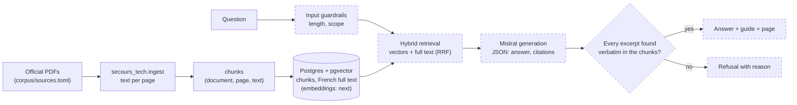
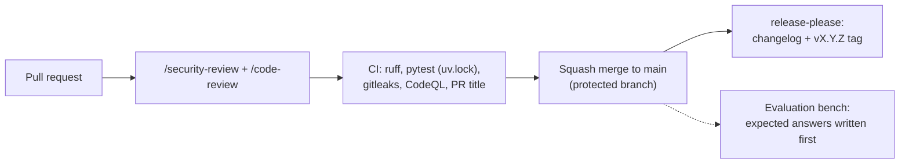

# SecoursTech

[](https://github.com/gabrielkpo/secours-tech/actions/workflows/ci.yml)
[](LICENSE)

An assistant for French firefighters that answers operational questions **only from the national
doctrine** (GDO, GTO, SSUAP, PSE), **cites the guide and page** behind every claim, and refuses
when the doctrine does not cover the question.

> **Status: early stage (milestone 1 of 12), expect breaking changes.** PDF ingestion and CI are
> on `main`, with the Postgres index; retrieval, generation and the API are not built yet.
> Personal project, not validated by the French civil protection: it does not replace training or
> command. See [Status / Roadmap](#status--roadmap).

## Why

A firefighter, trainer or trainee has a precise question ("safety perimeter around a high-voltage
line?", "what to do in a silo?"). The answer sits in national guides of up to 400 pages, published
as PDFs. Searching takes time; an approximate answer can be dangerous.

A general-purpose LLM answers fluently but invents figures and cannot say which page it relied on.
SecoursTech takes the opposite stance: an answer is shown only if every quoted passage is found
**word for word** in the retrieved doctrine, otherwise it refuses and says why.

**Why a rebuild.** v2 called the LLM from the browser, which exposed the API key in the JS
bundle, and committed 170+ MB of PDFs. v3 starts over: documents stay out of Git, and the planned API keeps
the key server-side behind a rate limit.

## How it works

Request path. Solid boxes exist on `main`; dashed boxes are the target design, not built yet.



Delivery and quality gates around the code:



**Technical choices and their trade-offs**

- **Postgres + pgvector rather than a hosted vector database**: one store for the index, the
  query log and the evaluation runs, so a dashboard can join them, at the cost of running
  Postgres ourselves. pgvector is enough for tens of thousands of chunks.
- **Hybrid retrieval (vectors + Postgres French full text)** rather than vectors only: the
  doctrine is full of acronyms, distances and form numbers that exact matching finds better.
- **Chunks cut on sentence boundaries, each keeping its document and page**: a citation is only
  possible if provenance survives ingestion. Repeated headers and footers are dropped first.
- **Citation check by string equality** rather than trusting the model: cheap, deterministic,
  and it also protects the integrity of the official text.
- **Ready-made Mistral models** (`mistral-embed`, generation) rather than a fine-tuned model:
  no training data is needed and the evaluation measures the whole system.
- **Documents listed, not committed**: `corpus/sources.toml` records each official URL and
  fingerprint. The ministry's site blocks bots, and the monthly watch does not pose as a browser:
  it opens an issue, a person downloads the PDFs, `collect register` files them.

## Example

Illustrative target output. The excerpt is a real chunk produced by the current ingestion; the
generation step that would return it does not exist yet.

```text
Question : Quel périmètre de sécurité par défaut autour d'une installation haute tension ENEDIS ?

{
  "answer": "10 mètres : c'est la zone d'exclusion par défaut que le COS met en œuvre pour une
             installation ENEDIS haute tension (A).",
  "citations": [
    {
      "document": "GDO Opérations en présence d'électricité",
      "page": 84,
      "excerpt": "ENEDIS Haute Tension (A) 10 mètres"
    }
  ],
  "refused": false
}
```

## Status / Roadmap

| Milestone | Content | State |
|---|---|---|
| J0 Scoping | Requirements, decisions, evaluation protocol | in review |
| J1 Corpus and extraction | PDF text per page, OCR of image-only pages, Postgres schema and loader | loader, page routing and OCR merged; per-guide OCR validation next |
| J2 Evaluation set v1 | 30 questions with expected answers and pages, written before any run | planned |
| J3 Retrieval | Embeddings, full text, hybrid fusion, chunk-size trials | planned |
| J4 Generation | Prompt, structured output, citation check, refusals | planned |
| J5 Local app | Query log, FastAPI with rate limit, minimal UI | planned |
| J6 Collection | Sources manifest, monthly watch, versions | done; downloads stay manual |
| J7 Production | Docker, server, HTTPS, CD with staging | planned |
| J8 Public MCP | `ask_doctrine`, `search_doctrine` (read-only) | planned |
| J9 Observability | Metrics, alerts, dashboard | planned |
| J10 Final evaluation | 60 to 100 cases, frozen test split, results in this README | planned |
| J11 Comparison | Same pipeline built with Mistral's managed tools (Document Library, OCR), scored on the same bench | planned |

**Evaluation plan.** Questions, expected facts and expected pages are written by hand from the
guides **before** the system runs, and are never shown to the model. Each case runs 3 times. Planned
measures: whether the right page is in the top 5 retrieved chunks, answer accuracy graded by hand,
rate of citations that pass the equality check, correct refusals on out-of-scope questions,
latency and cost per question. Serious faults (invented citation, figure absent from the sources,
out-of-scope question answered, individual medical advice) must stay at 0. Baselines: the LLM alone without retrieval, then each retrieval variant.

## Run it

Prerequisites: Python 3.11+, [uv](https://docs.astral.sh/uv/), poppler, Tesseract (local checker), a Mistral API key in `.env` (OCR), and the official PDFs in
`data/raw/` (not distributed here; see [Data and privacy](#data-and-privacy)).

```bash
uv sync --locked
createdb secours_tech                      # Postgres 17 with pgvector and unaccent
export DATABASE_URL=postgresql:///secours_tech
uv run python -m secours_tech.load data/raw          # text layer, page routes, sections
uv run python -m secours_tech.ocr data/raw           # Mistral OCR of the pages routed to OCR (needs MISTRAL_API_KEY)
uv run python -m secours_tech.ocr_bench index        # index the OCR of the guides that pass
uv run pytest                              # set TEST_DATABASE_URL to run the database tests
```

The loader applies the SQL migrations, then stores each PDF in `documents` (SHA-256, page count,
pages without text), its pages with their route, its sections read from the printed table of
contents, and its chunks in `chunks` (page, text, section and context, extraction method,
full-text vector). Running it twice changes nothing; after a change to the extraction or the
structure, `load data/raw --reextract` applies it to the guides already loaded. `ocr_bench index`
needs the hand transcriptions in `data/ocr-reference/` (kept out of Git) and writes its decision
to `corpus/ocr-validation.toml`. `.env.example` lists the Mistral key the next
milestones need (server side only).

## Project structure

| Path | Content |
|---|---|
| `src/secours_tech/extract.py`, `ingest.py` | Page text with poppler and its route (text, OCR, blank); chunking |
| `src/secours_tech/load.py`, `db.py`, `migrations/` | Postgres schema, migrations and the idempotent loader |
| `tests/` | Unit tests, and database tests against a dedicated `_test` database |
| `corpus/sources.toml`, `collect.py` | Official sources and the monthly watch |
| `docs/architecture.md` | Architecture decisions |
| `data/` | Local PDFs and generated index, ignored by Git |
| `.github/` | CI, secret scan, CodeQL, PR title check, Dependabot, release-please |

## Data and privacy

- **In the repository**: code, tests and documentation only. No PDF, no extracted text.
- **Never in the repository**: the doctrine documents, API keys (`.env` is ignored), user
  questions.
- **The guides** are published by the French Ministry of the Interior. They may be reproduced
  with their source and without alteration; reproduction rights are reserved and strictly
  limited, and commercial use is not allowed. SecoursTech therefore cites the guide and page and
  only displays verbatim excerpts.
- **Sent to a third party (planned)**: chunks of these public guides and the user's question go to
  the Mistral API to build embeddings and answers. The planned query log keeps no IP address or
  account, only an anonymous session.

## Limitations / next

- **Pages waiting for OCR.** Of the 2,993 pages of the 28 official guides, 1,192 are routed to
  OCR and 184 are blank. In 12 guides each line of text is drawn as an image; in 2 more
  (structure fires, ULM) the text layer is garbled by a font without a ToUnicode table; the
  rest are image pages. Their OCR text (Mistral OCR) is stored but indexed guide by guide, only
  once a hand-checked sample reads every number right and 99 % of the characters.
- **No answers yet.** Retrieval, generation and the citation check are designed but not built,
  so there are no results to report.
- **Scope.** National doctrine only: no departmental procedures, no field data, no medical advice
  for an individual case.

## Development

```bash
uv sync --locked
uv tool install pre-commit
pre-commit install       # ruff (through uv, locked version) and gitleaks before each commit
uv run pytest
```

One pull request per change, titled with Conventional Commits (`feat:`, `fix:`, `docs:`, `ci:`,
`chore:`). Each PR runs `/security-review` and `/code-review` before it is opened, then CI
(ruff, pytest, gitleaks, CodeQL, title check) on a protected `main`, and is squash-merged.
release-please maintains the changelog and the `vX.Y.Z` tags.

## License

The code is released under the [MIT License](LICENSE). The doctrine documents are not part of
this repository: they are published by the French Ministry of the Interior, whose reproduction
rights are reserved and strictly limited, and they may not be used for commercial purposes.
