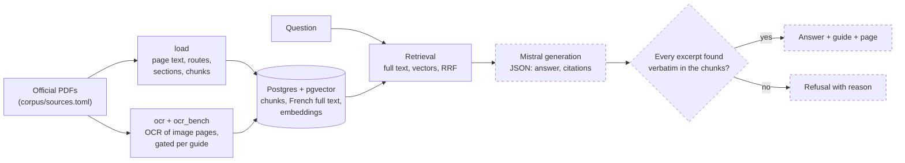

# SecoursTech

[](https://github.com/gabrielkpo/secours-tech/actions/workflows/ci.yml)
[](LICENSE)

An assistant for French firefighters, being built to answer operational questions **only from
the national doctrine** (GDO, GTO, SSUAP, PSE), **cite the guide and page** behind every claim,
and refuse when the doctrine does not cover the question.

> **Status: milestone 3 of 12, expect breaking changes.** The corpus, its OCR, the evaluation
> set and retrieval are built and measured; answer generation, the API and the interface are
> not built yet. Personal project, not validated by the French civil protection: it does not
> replace training or command. See [Roadmap](#roadmap).

## Why

A firefighter has a precise question ("safety perimeter around a high-voltage line?"). The
answer sits in national guides of up to 400 pages, published as PDFs: searching takes time, and
an approximate answer can be dangerous.

A general-purpose LLM answers fluently but invents figures and cites no page. SecoursTech will
show an answer only if every quoted passage is found **word for word** in the retrieved
doctrine; otherwise it refuses and says why.

**Why a rebuild.** v2 called the LLM from the browser, exposing its API key (since revoked),
and committed 170+ MB of PDFs. v3 keeps documents out of Git and the key server-side.

## How it works

Solid boxes exist on `main`; dashed boxes are designed, not built.



**Choices and their trade-offs**

- **Postgres + pgvector** rather than a hosted vector database: one store for the index, the
  query log and the evaluation runs, at the cost of running Postgres ourselves.
- **Provenance and figures preserved**: each chunk keeps its document, page and section path;
  headers are removed by position only, and no cut or note mark alters a number.
- **OCR gated per guide**: a guide's OCR text is indexed only if a hand-checked sample reads
  every number right.
- **Citation check by string equality** rather than trusting the model.
- **Documents listed, not committed**: `corpus/sources.toml` pins each official URL and
  SHA-256, and the loader refuses any other PDF.

Decisions are numbered in [docs/decisions.md](docs/decisions.md); the pipeline is detailed in
[docs/architecture.md](docs/architecture.md).

## Example

A synthetic example of the target output (the generation step does not exist yet):

```json
{
  "question": "Quelle distance de sécurité autour de l'installation ?",
  "answer": "25 mètres autour de l'installation, d'après le guide.",
  "citations": [
    {"document": "Guide de doctrine (exemple)", "page": 12, "excerpt": "25 mètres"}
  ],
  "refused": false
}
```

## Results

Retrieval on the 16 answered development cases. hit@k: an expected page among the first k;
recall@k: the share of a case's expected pages (2 to 13) among the first k. Each row comes from a
run record in [`eval/runs/`](eval/runs/) (commit, models, index and case fingerprints); protocol
and limits: [docs/EVALUATION.md](docs/EVALUATION.md).

| Retriever | Embedding | Reranker | n | hit@5 | recall@5 | hit@20 | recall@20 | MRR | s / question |
|---|---|---|---|---|---|---|---|---|---|
| fulltext | - | - | 16 | 0.62 | 0.26 | 0.81 | 0.50 | 0.43 | 0.1 |
| vector | `mistral-embed-2312` | - | 16 | 0.88 | 0.53 | 1.00 | 0.80 | 0.84 | 0.9 |
| hybrid | `mistral-embed-2312` | - | 16 | 0.88 | 0.54 | 0.94 | 0.70 | 0.78 | 0.7 |
| vector | `intfloat/multilingual-e5-base` | - | 16 | 0.94 | 0.61 | 0.94 | 0.74 | 0.94 | 0.2 |
| hybrid | `intfloat/multilingual-e5-base` | - | 16 | 0.94 | 0.55 | 0.94 | 0.69 | 0.86 | 0.2 |
| vector | `mistral-embed-2312` | `BAAI/bge-reranker-v2-m3` | 16 | 0.94 | 0.66 | 1.00 | 0.78 | 0.94 | 52.4 |
| vector | `intfloat/multilingual-e5-base` | `BAAI/bge-m3` | 16 | 0.94 | 0.67 | 0.94 | 0.77 | 0.94 | 66.2 |

One case is 6 points: the table ranks options, it does not prove small gaps. Vectors beat full
text by far; reranking raises recall but costs tens of seconds per question on a laptop CPU, far
above the 8 s target.

## Run it

Prerequisites: Python 3.11+, [uv](https://docs.astral.sh/uv/), Postgres 17 with pgvector and
unaccent, poppler, and the official PDFs listed in `corpus/sources.toml`, downloaded by hand
(they are not distributed here).

```bash
uv sync --locked
createdb secours_tech && cp .env.example .env     # set DATABASE_URL (and MISTRAL_API_KEY for OCR)
uv run python -m secours_tech.collect register ~/Downloads   # file the PDFs, check their SHA-256
uv run python -m secours_tech.load data/raw       # text layer, page routes, sections, chunks
uv run pytest                                     # set TEST_DATABASE_URL to run the database tests
```

The OCR, embedding and evaluation steps, their costs and their `--dry-run` options are in
[docs/RUNNING.md](docs/RUNNING.md).

## Roadmap

| Milestone | State |
|---|---|
| J0 Scoping: requirements, decisions, evaluation protocol | done |
| J1 Corpus: text per page, OCR, Postgres loader | done; 11 of 14 OCR guides indexed |
| J2 Evaluation set: 31 cases checked by a firefighter | done; 9 frozen for the final test |
| J3 Retrieval: embeddings, full text, fusion, reranking | measured; chunk-size trials to come |
| J4 Generation: structured answers, citation check, refusals | next |
| J5 App: FastAPI with rate limit, query log, minimal UI | planned |
| J6 Collection: sources manifest, monthly watch | done; downloads stay manual |
| J7 Production: Docker, Helm, Kubernetes, continuous deployment | planned |
| J8 Read-only MCP server | planned |
| J9 Observability | planned |
| J10 Final evaluation: 60 to 100 cases, test split scored once | planned |
| J11 The same bench on Mistral's managed tools | planned |

## Project structure

| Path | Content |
|---|---|
| `src/secours_tech/extract.py`, `structure.py`, `ingest.py` | Page text and route (text layer, OCR, blank), section tree, chunking |
| `src/secours_tech/load.py`, `db.py`, `migrations/` | Postgres schema, migrations and the loader |
| `src/secours_tech/ocr.py`, `ocr_bench.py`, `mistral.py` | OCR of image pages, the per-guide OCR gate, the Mistral client |
| `src/secours_tech/embed.py`, `rerank.py` | Embeddings (`mistral-embed`, local `multilingual-e5-base`) and local reranking |
| `src/secours_tech/bench.py`, `runs.py`, `eval/` | Evaluation bench, frozen test fingerprint, run records |
| `src/secours_tech/collect.py`, `corpus/` | Official sources manifest, monthly watch, OCR gate record |
| `docs/` | Architecture, decisions, evaluation, running the pipeline |

## Data and privacy

- **In the repository**: code, tests, docs, scores and fingerprints; no PDF, extracted text or
  evaluation case (they quote the doctrine, whose reproduction rights are reserved: see
  [License](#license)).
- **Sent to a third party today**: the guides' image pages (Mistral OCR), the chunk texts and
  the evaluation questions (Mistral embeddings), under Mistral's API terms; no personal data.
  Model weights come from Hugging Face at pinned revisions.
- **Planned**: user questions will go to the Mistral API to be answered; the query log will keep
  no IP address or account.

## Limitations

- **OCR text is checked on a sample.** 1,192 of the 2,993 pages are read by OCR. A guide's OCR
  text is indexed only if 4 hand-checked pages read every number right and 99 % of the
  characters: 11 of 14 guides pass, about a third of the index (`corpus/ocr-validation.toml`).
  Four pages bound the error rate, they do not prove every number, and the citation check
  compares answers with the OCR text: OCR-sourced figures will be flagged in answers. Structure
  fires and ULM (a misread number, and 2.2 % of characters for ULM) and the dog teams guide
  (2.8 % of characters) stay out of the index.
- **A small, unpublished bench.** 16 development and 9 frozen test cases: scores can be traced
  to their records, not rerun by others.
- **No answers yet.** Generation and the citation check are designed but not built.
- **Scope.** National doctrine only: no departmental procedures, no field data, no medical advice
  for an individual case.

## Development

```bash
uv sync --locked
uv tool install pre-commit && pre-commit install   # ruff and gitleaks before each commit
uv run pytest --cov      # coverage floor in pyproject.toml; mypy and ruff run in CI too
```

One pull request per change, titled with Conventional Commits and squash-merged into a
protected `main`. The code is written with Claude Code under the author's direction: each pull
request gets two automated reviews (`/security-review`, `/code-review`), recorded in the PR, and
CI (ruff, mypy, pytest with coverage, gitleaks, CodeQL); the author, a firefighter, is the only
human reviewer. release-please prepares releases; none has been published yet.

## License

The code is released under the [MIT License](LICENSE). The doctrine documents are not part of
this repository: they are published by the French Ministry of the Interior, whose reproduction
rights are reserved and strictly limited, and they may not be used for commercial purposes.
