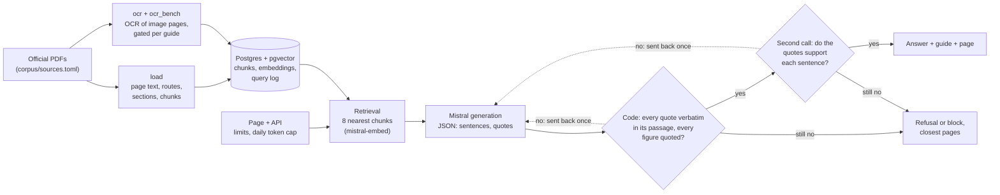

# SecoursTech

[](https://github.com/gabrielkpo/secours-tech/actions/workflows/ci.yml)
[](LICENSE)

An assistant for French firefighters, being built to answer operational questions **only from
the national doctrine** (GDO, GTO, SSUAP, PSE), **cite the guide and page** behind every claim,
and refuse when the doctrine does not cover the question.

> **Status: milestone 5 of 12, expect breaking changes.** Retrieval is measured, answers are
> scored by code but not graded by hand yet, and the API runs locally, not deployed. Personal
> project, not validated by the French civil protection: it does not replace training or
> command.

## Why

A firefighter has a precise question ("safety perimeter around a high-voltage line?"). The
answer sits in national guides of up to 400 pages, published as PDFs: searching takes time, and
an approximate answer can be dangerous.

A general-purpose LLM answers fluently but invents figures and cites no page. SecoursTech shows
an answer only if every quoted passage is found **word for word** in the retrieved doctrine;
otherwise it refuses and shows the closest pages.

**Why a rebuild.** v2 called the LLM from the browser, exposing API keys in its bundle, and
committed 170+ MB of PDFs. v3 keeps documents out of Git and the key server-side.

## How it works



**Choices and their trade-offs**

- **Postgres + pgvector** rather than a hosted vector database: one store for the index and the
  query log, at the cost of running Postgres ourselves.
- **Vectors only in production** (D21): full text, fusion and reranking are measured on the
  bench; reranking gains recall but costs tens of seconds per question on a CPU.
- **Citation check by string equality** rather than trusting the model, then a second call
  that can only block: a quote can be true and the sentence still say more than it.
- **Documents listed, not committed**: `corpus/sources.toml` pins each official URL and
  SHA-256, and the loader refuses any other PDF.

Decisions: [docs/decisions.md](docs/decisions.md); pipeline, API guards and checks:
[docs/architecture.md](docs/architecture.md).

## Example

The shape of an answer, on made-up text:

```text
- Un périmètre de 25 mètres est établi autour de l'installation. [1]

Sources
[1] Guide de doctrine (exemple) v1, page 12
    https://<official URL of the guide>#page=12
    « un périmètre de 25 mètres est établi autour de l'installation »

Information générale tirée de la doctrine : en intervention, le COS décide.
```

A refusal or a blocked answer shows only the closest pages.

## Results

Retrieval on the 16 answered development cases. hit@k: an expected page among the first k;
recall@k: the share of its expected pages among the first k. Each row comes from a record in
[`eval/runs/`](eval/runs/); protocol: [docs/EVALUATION.md](docs/EVALUATION.md).

| Retriever | Embedding | Reranker | n | hit@5 | recall@5 | hit@20 | recall@20 | MRR | s / question |
|---|---|---|---|---|---|---|---|---|---|
| fulltext | - | - | 16 | 0.62 | 0.26 | 0.81 | 0.52 | 0.40 | 0.0 |
| vector | `mistral-embed-2312` | - | 16 | 0.88 | 0.53 | 1.00 | 0.80 | 0.84 | 0.6 |
| hybrid | `mistral-embed-2312` | - | 16 | 0.88 | 0.54 | 0.94 | 0.70 | 0.78 | 0.9 |
| vector | `intfloat/multilingual-e5-base` | - | 16 | 0.94 | 0.61 | 0.94 | 0.74 | 0.94 | 0.2 |
| hybrid | `intfloat/multilingual-e5-base` | - | 16 | 0.94 | 0.55 | 0.94 | 0.70 | 0.86 | 0.2 |
| vector | `mistral-embed-2312` | `BAAI/bge-reranker-v2-m3` | 16 | 0.94 | 0.66 | 1.00 | 0.78 | 0.94 | 52.4 |
| vector | `intfloat/multilingual-e5-base` | `BAAI/bge-m3` | 16 | 0.94 | 0.67 | 0.94 | 0.77 | 0.94 | 66.2 |

Reranking raises recall at a latency far above the 8 s target.

Answers on the 22 development cases (16 the doctrine answers, 6 expecting a refusal), from the
latest record in [`eval/answers/`](eval/answers/): 8 of the 16 answerable cases get an answer,
each citing a page the case expects; 5 are blocked by the checks and 3 refused. One case
expecting a refusal was answered from another indexed guide and is to be reviewed. Hand grades
are not in yet.

## Run it

Prerequisites: Python 3.11+, [uv](https://docs.astral.sh/uv/), Postgres 17 with pgvector and
unaccent, poppler, and the official PDFs listed in `corpus/sources.toml`, downloaded by hand
(they are not distributed here).

```bash
uv sync --locked
createdb secours_tech && cp .env.example .env     # set DATABASE_URL and MISTRAL_API_KEY
uv run python -m secours_tech.collect register ~/Downloads   # file the PDFs, check their SHA-256
uv run python -m secours_tech.load data/raw       # text layer, page routes, sections, chunks
uv run uvicorn --factory secours_tech.api:create_app --no-proxy-headers   # http://127.0.0.1:8000
```

The API starts once the chunks are embedded: OCR, embeddings, benches, their costs and Docker
are in [docs/RUNNING.md](docs/RUNNING.md).

## Roadmap

| Milestone | State |
|---|---|
| J0 to J2: scoping, corpus and OCR, 31 evaluation cases checked by a firefighter | done |
| J3 Retrieval: embeddings, full text, fusion, reranking | measured |
| J4 Generation: structured answers, citation checks, refusals | in progress: hand grades next |
| J5 App: API, page, query log, limits | in progress: deployment behind the identity proxy next |
| J6 Collection: sources manifest, monthly watch | done |
| J7 Production: Docker, Helm, Kubernetes, continuous deployment | in progress: chart tested on kind |
| J8 to J11: MCP server, observability, final evaluation, Mistral's managed tools | planned |

## Project structure

| Path | Content |
|---|---|
| `src/secours_tech/` `extract`, `structure`, `ingest`, `load`, `ocr` | Page text, sections, chunks, OCR and its gate, the loader |
| `src/secours_tech/` `embed`, `rerank`, `bench` | Embeddings, reranking, the retrieval bench |
| `src/secours_tech/` `answer`, `answer_bench`, `api`, `web/` | Answers and their checks, the answer bench, the API and page |
| `corpus/`, `eval/` | Sources manifest, OCR gate record, run records |
| `Dockerfile`, `compose.yaml`, `deploy/` | Image (amd64, arm64), local stack, Helm chart tested on kind |
| `docs/` | Architecture, decisions, evaluation, running, deploying |

## Data and privacy

- **In the repository**: code, tests, docs, scores and fingerprints; no PDF, extracted text or
  evaluation case (they quote the doctrine, whose reproduction rights are reserved).
- **Sent to Mistral**: image pages (OCR), chunks and questions (embeddings), and for an answer
  the question, its 8 passages and the drafted sentences. Mistral's free API plan lets Mistral
  train on the data sent; the page tells users so before they ask.
- **Kept by the API**: each question, its status, the pages cited and the tokens used, without an
  IP address or account, deleted after 90 days. The page asks users not to type personal data.

## Limitations

- **OCR text is checked on a sample.** 11 of 14 OCR guides pass a gate of 4 hand-checked pages
  (every number, 99 % of characters); they are about a third of the index. Quotes from OCR pages
  are flagged in answers. Details in [docs/architecture.md](docs/architecture.md).
- **A small, unpublished bench.** 16 development and 9 frozen test cases, not rerunnable by
  others.
- **Answers are not graded yet.** Half the cases the doctrine answers get no answer, mostly
  complex situations and tasks by function. No similarity threshold refuses before the model is
  called: none separates the bench's cases yet. The number check compares figures, not their
  units, and not numbers written in words: the verification call is the only check of those.
- **No login of its own.** The API is meant to run behind the identity proxy (D25), not
  deployed yet; alone, it answers anyone who reaches it.
- **Scope.** National doctrine only: no departmental procedures, no medical advice.

## Development

```bash
uv sync --locked
uv tool install pre-commit && pre-commit install   # ruff, gitleaks, no file over 10 MB
createdb secours_tech_test
TEST_DATABASE_URL=postgresql:///secours_tech_test uv run pytest --cov   # the floor needs the database tests
```

One pull request per change, squash-merged into a protected `main`. The code is written with
Claude Code under the author's direction: each pull request gets two automated reviews
(`/security-review`, `/code-review`) and CI (ruff, mypy, pytest with coverage, gitleaks over the
whole history, CodeQL, the image started with its API); the author, a firefighter, is the only
human reviewer.

## License

The code is released under the [MIT License](LICENSE). The doctrine documents are not part of
this repository: they are published by the French Ministry of the Interior, whose reproduction
rights are reserved and strictly limited, and they may not be used for commercial purposes.
